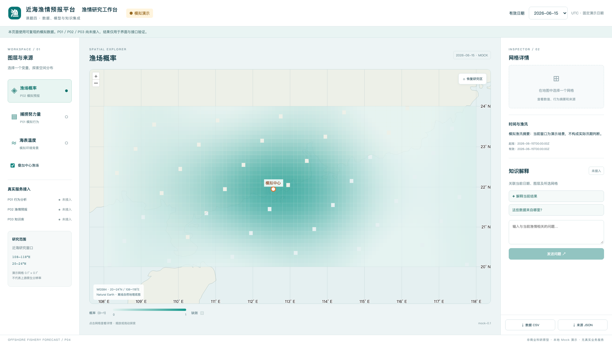

# Offshore Fishery Forecast Platform

[English](README.md) | [简体中文](README.zh-CN.md)

[](https://github.com/HuangXin-erniu/fishery-forecast-platform/actions/workflows/ci.yml)
[](LICENSE)
[](.nvmrc)

A standalone front-end prototype for integrated fishery forecasting. It provides an offline map, an OpenAPI 3.1 contract, and a reproducible mock service for platform-integration research.

> **Status: mock prototype.** All business data is synthetic and clearly labelled. The P01/P02/P03 upstream services are not connected. This repository is not the authoritative production platform, and its output must not be used for real fishing, navigation, or safety decisions.



*The interface is currently in Chinese. This README is available in English and Simplified Chinese.*

## Overview

The workbench is a browser-only prototype. A mock service worker serves four API endpoints; the map, panels, and exports consume those endpoints exactly as a future real service would. No backend, database, API key, or external tile service is required at runtime.

The prototype covers:

- an offline Natural Earth 1:50m land basemap;
- three synthetic layers: fishing-ground probability, fishing effort, and sea surface temperature;
- date and layer switching, a fishing-centre overlay, and native-grid inspection;
- context-aware mock knowledge explanations and free-form questions;
- CSV and provenance JSON export;
- an OpenAPI 3.1 contract and generated TypeScript types.

The P01/P02/P03 upstreams are shown as "not connected" in the UI. Replacing the mock with real services is a separate integration task; see [docs/api.md](docs/api.md).

## Quick start

Use Node.js 24.15.0 and npm 11.12.1 (the repository's `.nvmrc`):

```sh
git clone https://github.com/HuangXin-erniu/fishery-forecast-platform.git
cd fishery-forecast-platform
npm ci
npm run dev
```

Open <http://127.0.0.1:5173>. Press `Ctrl+C` to stop. The dev server uses a strict port: startup fails instead of silently choosing another port. The first install needs network access; after that the map and mock queries work offline.

## Scripts

| Command | Purpose |
|---|---|
| `npm run dev` | Start the Vite development server. |
| `npm run preview` | Preview the production build. |
| `npm run generate` | Regenerate `src/api-types.ts` from `configs/openapi.json`. |
| `npm run typecheck` | Run TypeScript without emitting files. |
| `npm run build` | Type-check and build the production bundle. |
| `npm test` | Run the unit and contract tests. |
| `npm run test:e2e` | Run the Playwright browser tests (desktop 1280 and 1920 viewports). |
| `npm run screenshot` | Build, start a local preview, and regenerate `docs/images/workbench-overview.png`. |

## API and data

The proposed contract is [configs/openapi.json](configs/openapi.json). The endpoints are served by the mock service worker under `/api/v1`:

- `GET /capabilities`
- `GET /map?date=<date>&layer_id=<layer>`
- `GET /cells/{cell_id}?date=<date>&layer_id=<layer>`
- `POST /knowledge/query`

Supported mock scenarios can be selected with `?scenario=empty`, `not_ready`, `error`, or `race`. See [docs/api.md](docs/api.md) for request and response details.

The fixed mock dates are 2026-06-15, 2026-06-16, and 2026-06-17 (UTC). The study window is 108–118°E, 20–24°N on a 0.1° demonstration grid. `null` means missing and `0` is a valid zero. The demonstration resolution is not the resolution of any real upstream product. See [docs/data.md](docs/data.md).

## Repository layout

```text
.
├── configs/                 OpenAPI contract and basemap source record
├── docs/                    Architecture, API, data, development and provenance
├── public/                  Offline land data and the mock service worker
├── src/
│   ├── components/          Presentational workbench panels
│   ├── App.tsx              State, requests and panel composition
│   └── model.ts             Mock data model and export helpers
├── tests/                   Unit, contract and browser tests
├── source-manifest.json     Source commit, path mapping and file hashes
└── README.md                This document
```

The component split under `src/components/` is intentionally shallow: the panels are presentational, while `App.tsx` owns state, abort handling, and request orchestration.

## Testing

```sh
npm test
npx playwright install chromium
npm run test:e2e
```

The suite contains 5 unit/contract tests and 12 browser tests (6 scenarios across two desktop viewports). The browser tests verify the offline map, layer and date switching, grid selection, exports, error retry, request races, zero-versus-missing display, and the absence of third-party requests.

## Data sources and licenses

- Land geometry: Natural Earth 1:50m land, public domain. Source URL, terms, and SHA-256 are recorded in [configs/basemap-source.json](configs/basemap-source.json).
- Application code: Apache License 2.0. See [LICENSE](LICENSE).
- Third-party dependencies retain their own licenses; the exact versions are pinned in `package-lock.json`.

The repository does not include real fishery data, models, run outputs, or P01/P02/P03 source code.

## Provenance

The initial front-end was published from the `t4_platform` subtree at commit `aee075f434fa63d99535c6ce14d734dbb7d3f76e`. This repository has independent history. `source-manifest.json` keeps the original commit, path mapping, and source-file hashes; the current-file hashes cover the state at this refactor.

See [docs/provenance.md](docs/provenance.md) for the mapping, exclusions, and verification steps.

## Contributing

Issues and pull requests are welcome. Before submitting a change, run:

```sh
npm run typecheck
npm test
npm run test:e2e
```

Do not commit generated browser output, real data, credentials, or run artifacts.

## License

Apache License 2.0. Copyright 2026 HuangXin-erniu.
