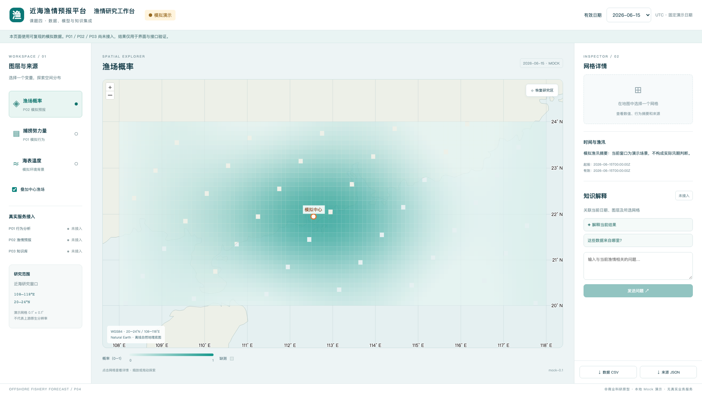

# 近海渔情预报平台

[English](README.md) | 简体中文

[](https://github.com/HuangXin-erniu/fishery-forecast-platform/actions/workflows/ci.yml)
[](LICENSE)
[](.nvmrc)

面向渔情预报集成的独立前端原型，提供离线地图、OpenAPI 3.1 契约和可复现的 Mock 服务，用于平台集成研究。

> **状态：Mock 原型。** 所有业务数据均为人工构造并明确标注；P01 / P02 / P03 上游服务尚未接入。本仓库不是权威生产平台，结果不得用于真实捕捞、航行或安全决策。



*界面当前为中文；README 提供英文和简体中文两个版本。*

## 概览

工作台是纯浏览器原型。Mock Service Worker 提供四个接口，地图、面板和导出都按未来真实服务的方式消费这些接口；运行时不需要后端、数据库、密钥或外部瓦片服务。

当前覆盖：

- 离线 Natural Earth 1:50m 陆地底图；
- 渔场概率、捕捞努力量、海表温度三个模拟图层；
- 日期与图层切换、中心渔场叠加、原生网格点选；
- 携带地图上下文的模拟知识解释与自由提问；
- CSV 与来源 JSON 导出；
- OpenAPI 3.1 契约及生成的 TypeScript 类型。

界面中的 P01 / P02 / P03 均显示“未接入”。把 Mock 替换为真实服务属于独立集成任务，见 [docs/api.md](docs/api.md)。

## 快速开始

使用 Node.js 24.15.0 与 npm 11.12.1（仓库提供 `.nvmrc`）：

```sh
git clone https://github.com/HuangXin-erniu/fishery-forecast-platform.git
cd fishery-forecast-platform
npm ci
npm run dev
```

浏览器打开 <http://127.0.0.1:5173>，`Ctrl+C` 停止。开发服务器使用固定端口，端口被占用时直接失败，不会静默换端口。首次安装依赖需要网络；之后地图与 Mock 查询均可离线使用。

## 脚本

| 命令 | 用途 |
|---|---|
| `npm run dev` | 启动 Vite 开发服务器。 |
| `npm run preview` | 预览生产构建。 |
| `npm run generate` | 从 `configs/openapi.json` 重新生成 `src/api-types.ts`。 |
| `npm run typecheck` | 只做 TypeScript 检查，不输出文件。 |
| `npm run build` | 类型检查并构建生产包。 |
| `npm test` | 运行单元与契约测试。 |
| `npm run test:e2e` | 运行 Playwright 浏览器测试（桌面 1280 与 1920 两个视口）。 |
| `npm run screenshot` | 构建并启动本地预览，重新生成 `docs/images/workbench-overview.png`。 |

## 接口与数据

提议契约见 [configs/openapi.json](configs/openapi.json)。Mock Service Worker 在 `/api/v1` 下提供：

- `GET /capabilities`
- `GET /map?date=<date>&layer_id=<layer>`
- `GET /cells/{cell_id}?date=<date>&layer_id=<layer>`
- `POST /knowledge/query`

可通过 `?scenario=empty`、`not_ready`、`error`、`race` 选择 Mock 场景。请求与响应细节见 [docs/api.md](docs/api.md)。

固定演示日期为 2026-06-15、2026-06-16、2026-06-17（UTC）；研究窗口为 108–118°E、20–24°N，演示网格 0.1°。`null` 表示缺测，`0` 表示有效零；演示分辨率不代表任何真实上游产品的原生分辨率。详见 [docs/data.md](docs/data.md)。

## 仓库结构

```text
.
├── configs/                 OpenAPI 契约与底图来源登记
├── docs/                    架构、接口、数据、开发与来源说明
├── public/                  离线陆地数据与 Mock Service Worker
├── src/
│   ├── components/          工作台展示组件
│   ├── App.tsx              状态、请求与面板编排
│   └── model.ts             Mock 数据模型与导出辅助
├── tests/                   单元、契约与浏览器测试
├── source-manifest.json     来源提交、路径映射与文件哈希
└── README.md                英文主文档
```

`src/components/` 只做展示拆分层：面板不持有业务状态，`App.tsx` 负责状态、取消请求与请求编排。

## 测试

```sh
npm test
npx playwright install chromium
npm run test:e2e
```

测试包含 5 项单元/契约测试和 12 项浏览器测试（6 个场景 × 2 个桌面视口），覆盖离线地图、日期与图层切换、网格点选、导出、错误重试、请求竞态、零与缺测区分，以及无非同源请求。

## 数据来源与许可

- 陆地几何：Natural Earth 1:50m 陆地数据，public domain；来源、条款与 SHA-256 见 [configs/basemap-source.json](configs/basemap-source.json)。
- 应用代码：Apache License 2.0，见 [LICENSE](LICENSE)。
- 第三方依赖保留各自许可证；具体版本固定在 `package-lock.json`。

本仓库不包含真实渔情数据、模型、运行产物或 P01 / P02 / P03 源码。

## 来源与版本

初始前端发布自 `t4_platform` 子树的提交 `aee075f434fa63d99535c6ce14d734dbb7d3f76e`。本仓库使用独立历史；`source-manifest.json` 保留原始提交、路径映射与源文件哈希，当前文件哈希覆盖本次重构后的状态。

路径映射、排除项与复核步骤见 [docs/provenance.md](docs/provenance.md)（英文）。

## 参与贡献

欢迎提交 Issue 与 Pull Request。提交前请运行：

```sh
npm run typecheck
npm test
npm run test:e2e
```

不要提交浏览器输出、真实数据、凭据或运行产物。

## 许可证

Apache License 2.0。Copyright 2026 HuangXin-erniu。
